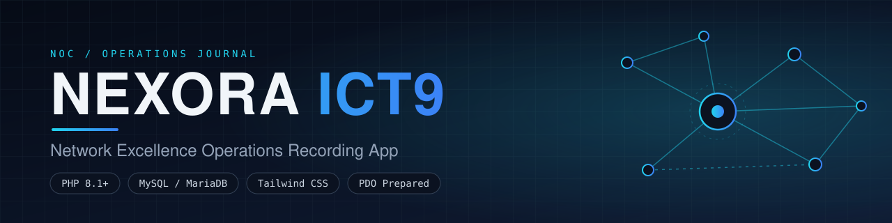
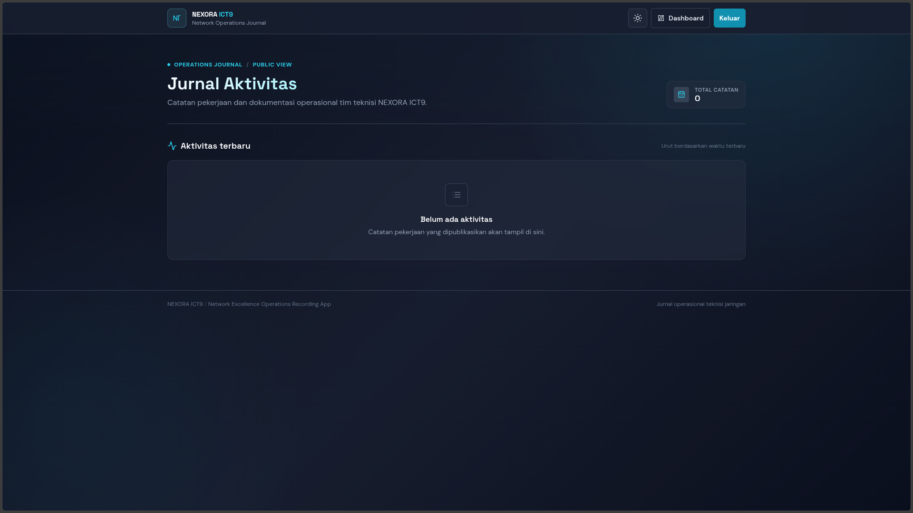
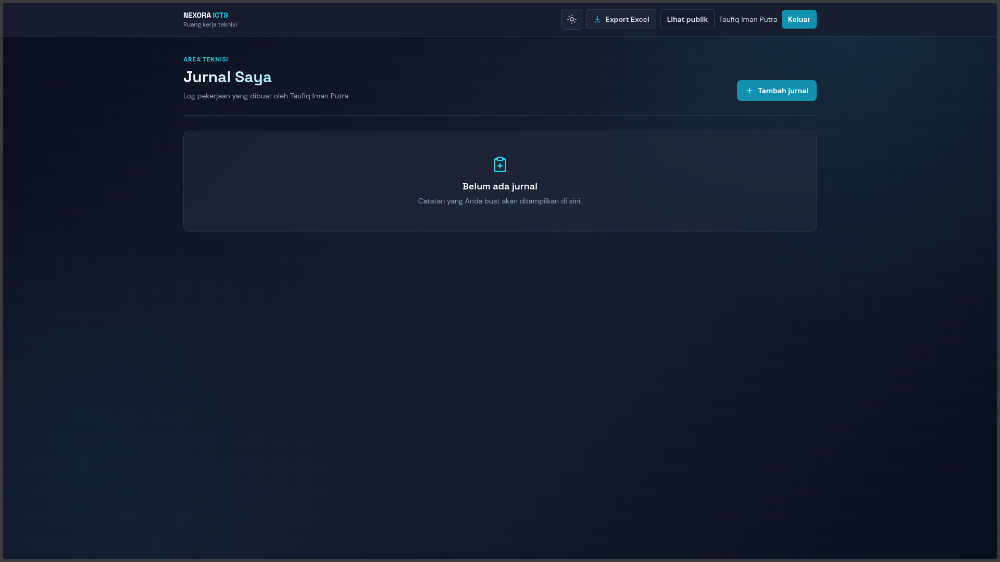
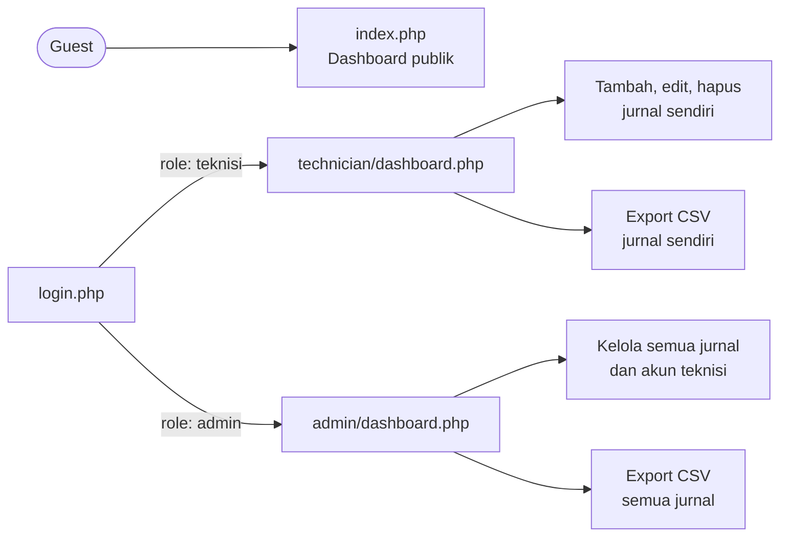
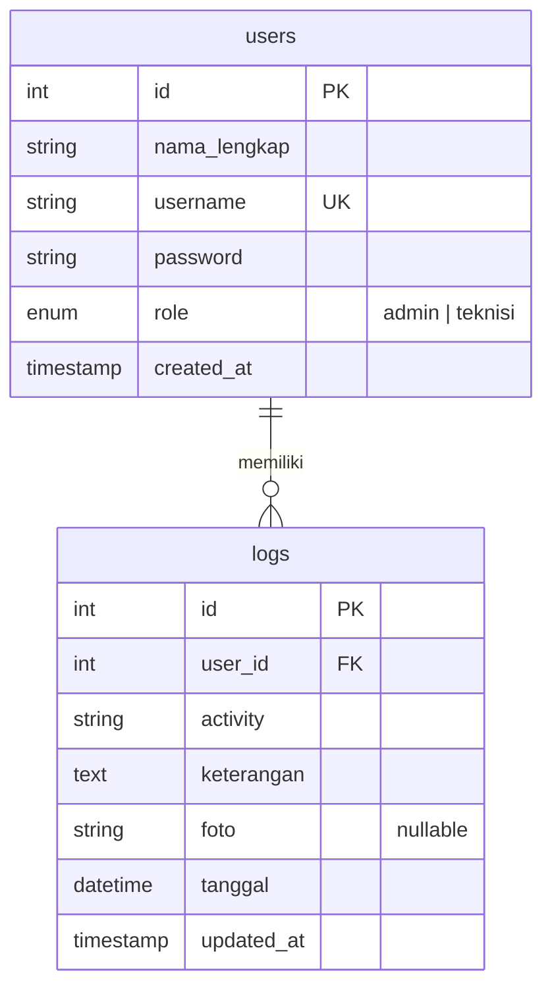

<div align="center">



<br>

**Jurnal pekerjaan dan catatan operasional untuk teknisi jaringan / ICT.**
Satu tempat untuk mencatat, memantau, dan mengekspor pekerjaan lapangan.

<br>


[Ringkasan](#ringkasan) ·
[Tampilan](#tampilan) ·
[Quick Start](#quick-start) ·
[Instalasi](#instalasi) ·
[Role & Akses](#role--hak-akses) ·
[Database](#struktur-database) ·
[Struktur Proyek](#struktur-proyek)

</div>

<br>

> [!WARNING]
> Password pada proyek ini disimpan sebagai **teks biasa**. Gunakan hanya untuk pengembangan atau jaringan internal yang terkontrol, jangan di internet publik. Untuk produksi, hash password dan ganti seluruh kredensial seed (lihat [Hardening](#hardening-sebelum-produksi)).

## Ringkasan

NEXORA ICT9 dibuat dengan **PHP Native**, **MySQL/MariaDB**, dan **Tailwind CSS**, tanpa framework backend. Teknisi mencatat pekerjaan lengkap dengan waktu dan foto bukti, admin memantau semuanya, dan tamu cukup membuka dashboard publik yang bersifat read-only.

<table align="center">
  <tr>
    <td align="center"><h3>3</h3><sub>role pengguna<br>Guest · Teknisi · Admin</sub></td>
    <td align="center"><h3>2 MB</h3><sub>batas foto per jurnal<br>JPG · PNG · WEBP</sub></td>
    <td align="center"><h3>CSV</h3><sub>export kompatibel Excel<br>dengan filter tanggal</sub></td>
    <td align="center"><h3>PDO</h3><sub>seluruh query memakai<br>prepared statements</sub></td>
  </tr>
</table>

### Fitur utama

<table>
  <tr>
    <td width="50%" valign="top">
      <b>Kontrol akses berbasis role</b><br>
      Guest hanya melihat jurnal. Teknisi mengelola jurnal miliknya. Admin mengelola semua jurnal dan akun teknisi. Halaman admin dan teknisi dijaga oleh session dan pemeriksaan role.
    </td>
    <td width="50%" valign="top">
      <b>Dashboard responsif &amp; Pencarian</b><br>
      Table view di tablet dan desktop, card view di mobile, tanpa scroll horizontal. Dilengkapi fitur pencarian kata kunci cepat, filter rentang tanggal, urutan waktu, dan ringkasan statistik (total log, aktivitas bulan ini, dan ada foto).
    </td>
  </tr>
  <tr>
    <td valign="top">
      <b>Dark / Light mode</b><br>
      Default dark bergaya NOC. Pilihan tema disimpan di <code>localStorage</code> dan berlaku di semua halaman.
    </td>
    <td valign="top">
      <b>Tanggal pekerjaan manual</b><br>
      Form <code>datetime-local</code> terisi otomatis dengan waktu saat ini dan tetap bisa diedit, cocok untuk mencatat pekerjaan yang terlewat.
    </td>
  </tr>
  <tr>
    <td valign="top">
      <b>Foto opsional &amp; Kelola Bukti</b><br>
      Maksimal satu foto per jurnal (JPG, PNG, WEBP, maks. 2 MB). Tersedia opsi menghapus foto dokumentasi saat edit jurnal.
    </td>
    <td valign="top">
      <b>Keamanan &amp; Akun</b><br>
      Fitur ganti password mandiri untuk Teknisi dan Admin, serta kemampuan Admin untuk mereset password akun teknisi secara langsung.
    </td>
  </tr>
  <tr>
    <td valign="top" colspan="2">
      <b>Export Excel &amp; Custom Modal</b><br>
      Admin mengekspor semua jurnal, teknisi hanya jurnal miliknya dengan filter tanggal. Konfirmasi hapus, notifikasi, filter export, dan pratinjau foto memakai modal aplikasi.
    </td>
  </tr>
</table>

Jurnal pada dashboard juga dikelompokkan otomatis berdasarkan bulan aktivitas, dengan judul berformat **Bulan Tahun** (contoh: “Oktober 2026”). Grup bulan hanya muncul jika ada jurnal pada bulan tersebut.

## Tampilan

<table>
  <tr>
    <td width="50%" align="center">
      
    </td>
    <td width="50%" align="center">
      
    </td>
  </tr>
  <tr>
    <td align="center"><sub><b>Dashboard publik</b><br>Daftar jurnal read-only dan pengganti tema dark/light</sub></td>
    <td align="center"><sub><b>Panel teknisi</b><br>Form input jurnal dengan tanggal otomatis dan foto opsional</sub></td>
  </tr>
</table>


## Alur Aplikasi



## Quick Start

Untuk mencoba cepat di lokal (PHP 8.1+ dan MySQL/MariaDB sudah berjalan):

```sh
# 1. Import schema dan akun seed
mysql -u root -p < database.sql

# 2. Beri akses tulis folder foto ke user web server (contoh: Apache XAMPP Linux)
setfacl -m u:daemon:rwx -m d:u:daemon:rwx uploads

# 3. Jalankan server
php -S 127.0.0.1:8000 -t .
```

Buka <http://127.0.0.1:8000> lalu login dengan [akun seed](#akun-seed). Detail setiap langkah ada di bagian berikut.

## Instalasi

### Prasyarat

| Kebutuhan | Keterangan |
|---|---|
| PHP | 8.1 atau lebih baru, dengan ekstensi `pdo_mysql`, `fileinfo`, `session` |
| Database | MySQL atau MariaDB |
| Browser | Modern, JavaScript dan `localStorage` aktif |
| Internet | Diperlukan untuk Tailwind CDN, Lucide Icons, dan Google Fonts |
| Folder `uploads/` | Dapat ditulis oleh user proses web server |

### 1. Letakkan proyek

Clone atau salin ke folder kerja web server. Untuk XAMPP di Linux, lokasi umumnya `/opt/lampp/htdocs/nexora-ict9`.

### 2. Import database

```sh
mysql -u root -p < database.sql
```

Jika MySQL lokal tidak memakai password, gunakan `mysql -u root < database.sql`. Skrip membuat database `nexora_ict9`, tabel `users` dan `logs`, serta akun seed.

> [!NOTE]
> Skrip ditujukan untuk instalasi baru. `CREATE TABLE IF NOT EXISTS` tidak memigrasikan schema lama.

### 3. Konfigurasi koneksi

`config/database.php` membaca environment variable berikut. Nilai default dipakai bila variabel tidak diset.

| Variabel | Default |
|---|---|
| `DB_HOST` | `127.0.0.1` |
| `DB_PORT` | `3306` |
| `DB_NAME` | `nexora_ict9` |
| `DB_USER` | `root` |
| `DB_PASSWORD` | *(kosong)* |

Atur variabel ini sebelum menjalankan PHP jika konfigurasi MySQL Anda berbeda. Koneksi memakai PDO dengan exception mode dan native prepared statements.

### 4. Izin folder `uploads/`

Folder harus dapat ditulis oleh proses web server. **Jangan** memakai permission `777`. Contoh untuk XAMPP Linux dengan Apache sebagai `daemon`:

```sh
setfacl -m u:daemon:rwx -m d:u:daemon:rwx uploads
```

Ganti `daemon` dengan user Apache/PHP di sistem Anda. Untuk PHP built-in server, jalankan server sebagai user yang punya hak tulis ke folder tersebut.

### Menjalankan aplikasi

<table>
  <tr>
    <th width="50%">PHP Built-in Server</th>
    <th width="50%">XAMPP</th>
  </tr>
  <tr>
    <td valign="top">

```sh
php -S 127.0.0.1:8000 -t .
```

Buka <http://127.0.0.1:8000>. Pastikan variabel `DB_*` sudah tersedia di terminal bila tidak memakai default.

</td>
    <td valign="top">

1. Letakkan proyek di `htdocs/`.
2. Jalankan Apache dan MySQL.
3. Import `database.sql` via phpMyAdmin atau MySQL CLI.
4. Buka <http://localhost/nexora-ict9/>.
5. Jika foto gagal tersimpan, beri akses tulis pada `uploads/` hanya untuk user proses Apache.

</td>
  </tr>
</table>

## Akun Seed

| Role | Username | Password awal |
|---|---|---|
| Admin | `admin` | `admin123` |
| Teknisi | `teknisi` | `teknisi123` |

> [!CAUTION]
> Ganti password default sebelum dipakai bersama.

## Role & Hak Akses

| Kemampuan | Guest | Teknisi | Admin |
|---|:---:|:---:|:---:|
| Melihat dashboard publik (read-only) | Ya | Ya | Ya |
| Login | n/a | Ya | Ya |
| Tambah jurnal | – | Ya | – |
| Edit dan hapus jurnal sendiri | – | Ya | Ya |
| Edit dan hapus jurnal semua teknisi | – | – | Ya |
| Export Excel | – | Jurnal sendiri | Semua jurnal |
| Tambah dan hapus akun teknisi | – | – | Ya |

- **Teknisi** diarahkan ke `technician/dashboard.php` dan hanya dapat mengakses jurnal dengan `user_id` miliknya. Foto boleh dikosongkan saat tambah maupun edit.
- **Admin** diarahkan ke `admin/dashboard.php` dan mengelola akun teknisi melalui `admin/manage-users.php`.

### Catatan export

Tombol **Export Excel** membuka modal pemilihan tanggal. Hasilnya adalah **CSV UTF-8 dengan pemisah titik koma (`;`)** yang dapat dibuka di Excel. Berkas ini bukan format XLSX.

## Struktur Database



<details>
<summary><b>Detail kolom</b></summary>

<br>

**`users`**

| Kolom | Keterangan |
|---|---|
| `id` | INT unsigned, primary key, auto increment |
| `nama_lengkap` | Nama pengguna |
| `username` | Unik, dipakai untuk login |
| `password` | Teks biasa pada konfigurasi saat ini |
| `role` | `admin` atau `teknisi` |
| `created_at` | Waktu pembuatan akun |

**`logs`**

| Kolom | Keterangan |
|---|---|
| `id` | INT unsigned, primary key, auto increment |
| `user_id` | Foreign key ke `users.id` |
| `activity` | Judul pekerjaan |
| `keterangan` | Deskripsi pekerjaan |
| `foto` | Nama file foto, nullable |
| `tanggal` | DATETIME pekerjaan, default `CURRENT_TIMESTAMP`, dapat diatur manual dari form |
| `updated_at` | Waktu perubahan terakhir |

</details>

> [!IMPORTANT]
> Foreign key memakai `ON DELETE RESTRICT`. Akun teknisi yang masih memiliki jurnal tidak dapat dihapus sampai jurnalnya ditangani.

## Struktur Proyek

<details>
<summary><b>Lihat struktur folder</b></summary>

```text
nexora-ict9/
├── admin/
│   ├── _bootstrap.php       # Guard admin dan helper validasi
│   ├── dashboard.php        # Monitoring semua jurnal
│   ├── log-delete.php       # Hapus jurnal sebagai admin
│   ├── log-edit.php         # Edit jurnal teknisi mana pun
│   └── manage-users.php     # Tambah/hapus akun teknisi
├── assets/
│   ├── app.js               # Theme switcher dan custom modal
│   ├── export-modal.php     # Modal filter tanggal untuk export
│   ├── theme.css            # Background, glass surface, dan animasi
│   └── theme.js             # Terapkan preferensi tema sebelum render
├── config/
│   └── database.php         # Koneksi PDO dari environment
├── docs/                    # Banner dan screenshot untuk README
├── technician/
│   ├── _bootstrap.php       # Guard teknisi dan helper jurnal/upload
│   ├── add.php              # Form tambah jurnal
│   ├── dashboard.php        # Daftar jurnal milik teknisi
│   ├── delete.php           # Hapus jurnal milik teknisi
│   ├── edit.php             # Edit jurnal milik teknisi
│   ├── log-add.php          # Alias menuju add.php
│   ├── log-delete.php       # Alias menuju delete.php
│   └── log-edit.php         # Alias menuju edit.php
├── uploads/                 # Foto saat runtime; harus dapat ditulis web server
├── database.sql             # Schema dan akun seed
├── export-excel.php         # Export CSV dengan filter role dan tanggal
├── index.php                # Dashboard publik read-only
├── login.php                # Autentikasi dan redirect berdasarkan role
├── logout.php               # Hapus session
└── README.md
```

</details>

## Hardening Sebelum Produksi

- [ ] Ganti password seed `admin123` dan `teknisi123`
- [ ] Simpan password sebagai hash (`password_hash()` dan `password_verify()`)
- [ ] Pakai user database khusus dengan password kuat, bukan `root`
- [ ] Aktifkan HTTPS
- [ ] Pastikan `uploads/` tidak mengeksekusi PHP dan tidak berizin `777`

---

<div align="center">
<sub>NEXORA ICT9 · Network Excellence Operations Recording App</sub>
</div>